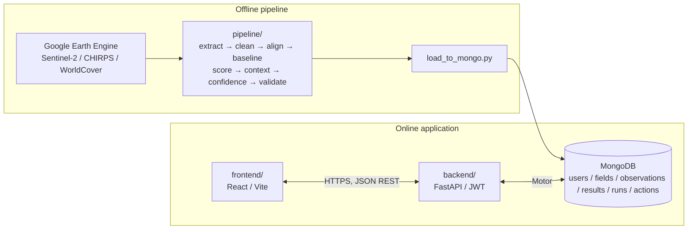
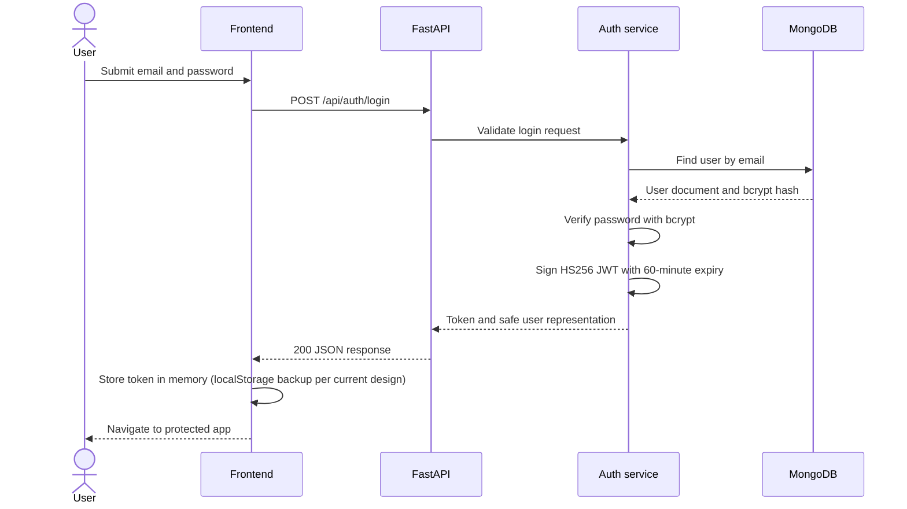
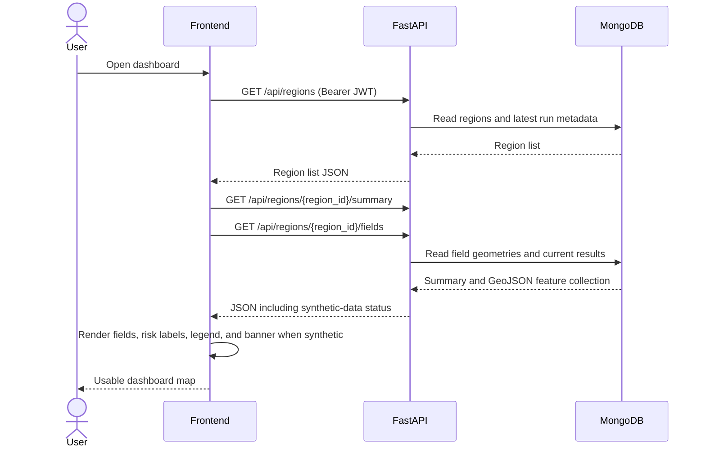
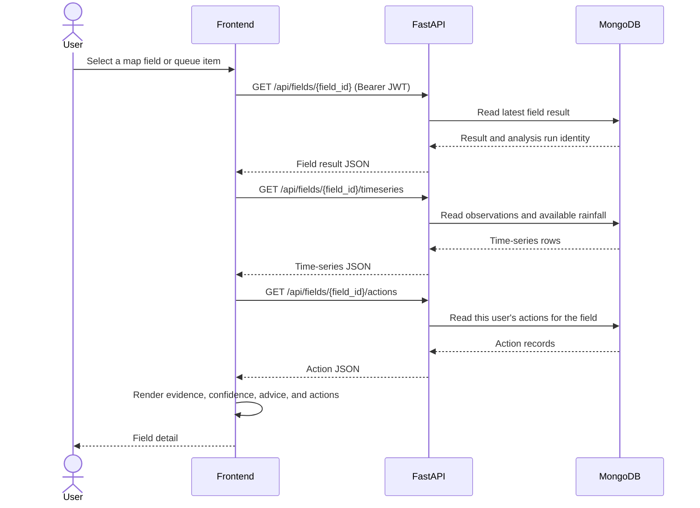
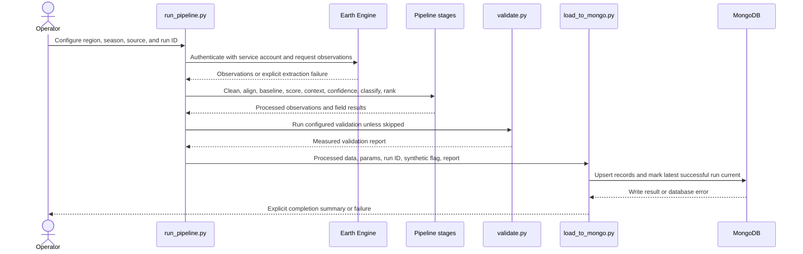
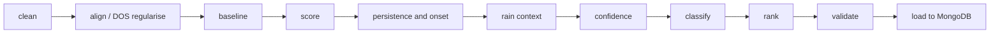
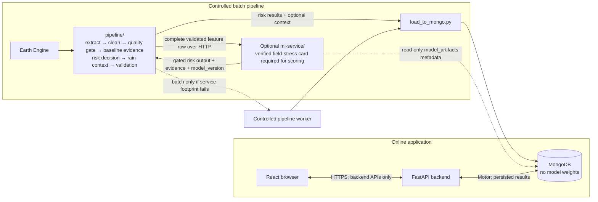

# CropShield AI: System Architecture and File Structure

Single source of truth for the team and for GitHub Copilot. Read this before writing any code.

## 1. Key decisions

| Area | Decision | Why |
|---|---|---|
| Repo layout | Separate `frontend/`, `backend/`, `pipeline/`, and optional internal `ml-service/` | Model inference is isolated from the user-facing backend; the service is gated and optional |
| Frontend | React + Vite + TypeScript, Tailwind, React Router, TanStack Query, Axios, react-leaflet, Recharts, i18next | Fast to build, matches the UXPilot design export |
| Backend | Python 3.11+, FastAPI, Pydantic v2, Motor (async MongoDB driver), PyJWT, bcrypt | Async, typed, auto docs at `/docs` |
| Database | MongoDB Atlas in production; locally installed MongoDB or a separate Atlas development database | Fits GeoJSON fields and time series |
| Auth | Email + password, bcrypt hash, JWT bearer access token | Requested; simple and standard |
| CORS | FastAPI `CORSMiddleware`, allowed origins from env var | Frontend and backend on different origins |
| Earth Engine | Used only by `pipeline/`, with a **service account JSON key** | See note below |
| ML and risk | Existing pipeline stress detector (robust baseline evidence, persistence, data quality, rainfall context, confidence) remains the risk source until a replacement passes validation. The audited nested model is optional crop-type context only, not stress detection. | The nested model is not a validated field-season stress model; see `MODEL_DECISION.md`. |

**Important correction on the "Earth Engine API key":** Earth Engine does not use a simple API key. Server-side access uses a Google Cloud project registered for Earth Engine plus a **service account** and its JSON key file. Keep that key only in `pipeline/` environment variables or a secret manager. Never put it in the frontend, never in the backend web server, never in Git.

## 2. Architecture

```
                        OFFLINE (run on a developer machine or a scheduled job)
 +------------------------------------------------------------------------------+
 |  Google Earth Engine  --->  pipeline/ (Python, pandas, scikit-learn)         |
 |  Sentinel-2, CHIRPS,        extract -> clean -> baseline -> score ->         |
 |  WorldCover                 context -> confidence -> risk -> validate        |
 |                                          |                                   |
 |                                          v  load_to_mongo.py                 |
 +------------------------------------------|-----------------------------------+
                                            v
                                   +------------------+
                                   |     MongoDB      |
                                   +--------^---------+
                                            |  Motor
                        ONLINE              |
 +-----------------------------+   +--------+---------+
 |  frontend/ (React, Vite)    |   | backend/ FastAPI |
 |  Login, Dashboard map,      |-->| JWT auth, CORS,  |
 |  Field detail, Queue,       |<--| read APIs,       |
 |  Methodology, i18n          |   | actions API      |
 +-----------------------------+   +------------------+
        HTTPS + Bearer JWT
```

**Why batch, not live:** Earth Engine calls are slow and quota-limited. Precomputing results into MongoDB makes the demo fast and reliable, and means the web backend never holds Earth Engine credentials.

### Component responsibilities

| Component | Does | Does NOT |
|---|---|---|
| `pipeline/` | Pulls GEE data, runs the ML pipeline, validates, writes results to MongoDB | Serve HTTP, handle users |
| `backend/` | Auth, serve persisted results, store user actions, expose methodology and metrics; proxy explicit authenticated ML status/model-info/score-preview requests over HTTP | Call Earth Engine, recompute or persist preview scores, import model/pipeline/service code, call the ML service for ordinary dashboard/map/chart requests |
| `frontend/` | UI, map, charts, language, read-aloud | Hold secrets, compute risk |
| `ml-service/` | Optional, checksum-verified inference over internal HTTP; read-only `model_artifacts` metadata lookup. Scoring requires a verified field-level crop-stress model card and supported mappings; the audited crop-type model is rejected for risk scoring. | Train, call Earth Engine, write to MongoDB, read operational data, or use crop-type output as project risk |
| MongoDB | Stores users, fields, observations, results, actions | Store satellite pixels |

## 3. Shared constants (defined once in `packages/cropshield_core/config.py`)

These must match everywhere. Note: day-of-season (DOS) counts from **1 November**, to match the extraction script (not 1 October).

| Constant | Value |
|---|---|
| Season window | 1 Nov to 31 Mar (rabi) |
| Baseline seasons | 2019-20 to 2024-25 |
| Current season | 2025-26 |
| `MIN_VALID_FRAC` | 0.5 |
| `SPIKE_DELTA` | 0.2 |
| `MAX_INTERP_GAP_DAYS` | 20 |
| `DOS_WINDOW` | 12 days |
| `MIN_BASELINE_YEARS` | 3 |
| `SIGMA_FLOOR` | 0.05 |
| `Z_WATCH` | -1.5 |
| `Z_HIGH` | -2.0 |
| `DEV_HIGH_PCT` | 20 |
| `STALE_DAYS` | 20 |
| `CS_THRESHOLD` (cloud score) | 0.6 |

All are starting values to be tuned. They are saved with each analysis run and shown on the Methodology page.
The frozen `PipelineConfig` also holds clustering, persistence, confidence, ranking, rainfall,
optional CUSUM/Isolation Forest, Earth Engine retry/chunking, and validation sweep/injection
settings. `pipeline/config.py` re-exports the shared config and calendar helpers to preserve existing
pipeline imports. The target inference path retires k-means and Isolation Forest; removal from code is
deferred until the existing risk fallback is verified without them. Keep active risk thresholds in
the shared core config until a validated stress-model replacement exists. The complete effective
configuration is stored in `analysis_runs.params`; validation reports are associated with the run
that computed them.

## 4. Risk vocabulary (used identically in pipeline, API and UI)

| Field | Allowed values |
|---|---|
| `risk` | `normal`, `watch`, `alert`, `cannot_assess` |
| `severity` (only when `risk=alert`) | `moderate`, `high` |
| `confidence_label` | `high`, `medium`, `low` |
| `confidence` | float 0 to 1 |

## 5. MongoDB collections

| Collection | Key fields | Indexes |
|---|---|---|
| `users` | `email`, `password_hash`, `name`, `role` (`officer`/`farmer`), `language`, `created_at` | unique `email` |
| `regions` | `name`, `state`, `bbox`, `centroid` | none |
| `fields` | `region_id`, `field_id`, `name`, `geometry` (GeoJSON Polygon), `area_ha`, `is_synthetic_boundary`, `cluster` | `2dsphere` on `geometry`; `region_id`; unique `field_id` |
| `seasons` | `season_id`, `label`, `start`, `end`, `role` (`baseline`/`current`) | unique `season_id` |
| `observations` | Current-season `field_id`, `season_id`, `date`, `dos`, `ndvi`, `valid_frac`, `baseline_median`, `baseline_sigma`, `z`, `pct_dev`, `is_interpolated`, `low_quality` | unique `(field_id, season_id, date)` |
| `rainfall` | Current-season `region_id`, `season_id`, `date`, `rain_mm`, `rain14`, `rain30`, `rain_z` | `(region_id, season_id, date)` |
| `field_results` | `field_id`, `region_id`, `season_id`, `run_id`, `risk`, `severity`, `confidence`, `confidence_label`, `crop_type`, `model_version`, `model_score`, `top_factors`, `evidence`, `decision_threshold`, `z_score`, `pct_below_normal`, `drop_start`, `latest_obs_date`, `n_valid_obs`, `baseline_years`, `rain_context`, `advice_key`, `advice`, `priority_score`, `priority_rank`, legacy `if_flag` | `(region_id, season_id, run_id, priority_rank)` |
| `analysis_runs` | `run_id`, `created_at`, `params` (all constants), `model_version`, `model_checksum`, `is_synthetic`, `n_fields`, `notes` | unique `run_id`; `created_at` |
| `model_metadata` | `model_version`, `task`, `feature_names`, `class_names`, `sha256`, `runtime`, `trained_on`, `attribution`, `metrics`, `limitations` | unique `model_version`; metadata only, no weights |
| `model_artifacts` | `model_version`, model-card metadata, artifact checksums, measured evaluation report, `status` (`candidate`/`active`/`inactive`), `weights_stored=false` | unique `model_version`; metadata only, no weights; activate transactionally so exactly one version is active |
| `validation_reports` | `run_id`, `loyo` (false alerts per field-season), `injection` (recall, FAR, delay, F1, per magnitude), `thresholds_sweep` | `run_id` |
| `actions` | `user_id`, `field_id`, `status` (`pending`/`done`/`needs_expert`), `note`, `created_at`, `updated_at` | `(field_id, user_id)` |

To limit database storage, `pipeline/load_to_mongo.py` persists only the
current season's observations and rainfall rows for the loaded fields/region;
older rows for those same fields/region are replaced. Current observation
documents retain the measured baseline median, spread, and anomaly values
needed to plot the baseline band. Field-level `evidence` carries the latest
available comparison. Historical raw time-series rows are not stored in
MongoDB. Synthetic seed generation uses the same pipeline scorer and keeps
`is_synthetic=true`; it does not produce model predictions or accuracy
evidence. `model_version` and `model_checksum` are null when no approved model
artifact contributed to a run.

## 6. API contract (backend)

Base path `/api`. All endpoints except `health`, `auth/register`, `auth/login`, `methodology` need `Authorization: Bearer <JWT>`.

| Method | Path | Returns |
|---|---|---|
| GET | `/health` | `{status:"ok"}` |
| POST | `/auth/register` | `{access_token, token_type, user}` |
| POST | `/auth/login` | `{access_token, token_type, user}` |
| GET | `/auth/me` | current user |
| PATCH | `/auth/me` | update `name`, `language` |
| GET | `/regions` | list of regions with latest run info |
| GET | `/regions/{region_id}/summary` | counts by risk, latest observation date, run id, `is_synthetic` flag |
| GET | `/regions/{region_id}/fields` | GeoJSON FeatureCollection; each feature's properties hold the result fields |
| GET | `/regions/{region_id}/queue` | ranked inspection list (query: `risk`, `limit`) |
| GET | `/fields/{field_id}` | full result for one field |
| GET | `/fields/{field_id}/timeseries` | observations, baseline band, rainfall, `drop_start` |
| GET | `/fields/{field_id}/actions` | actions by the current user |
| POST | `/fields/{field_id}/actions` | create an action |
| PATCH | `/actions/{action_id}` | update status or note |
| GET | `/methodology` | thresholds, method steps, validation metrics, limitations |

Example `field_results` feature properties:

```json
{
  "field_id": "F012",
  "risk": "alert",
  "severity": "moderate",
  "confidence": 0.62,
  "confidence_label": "medium",
  "crop_type": null,
  "model_version": null,
  "model_score": null,
  "top_factors": null,
  "evidence": null,
  "decision_threshold": null,
  "z_score": -2.1,
  "pct_below_normal": 24,
  "drop_start": "2026-01-14",
  "latest_obs_date": "2026-02-08",
  "n_valid_obs": 3,
  "baseline_years": 6,
  "rain_context": "dry_spell",
  "advice": "Check soil moisture and irrigation status in this field.",
  "priority_rank": 3,
  "is_synthetic": false
}
```

Illustrative response shape only; no example measurement is asserted. Risk,
severity, and confidence come from the pipeline. Model fields remain null
unless a model passes its gates and supplies the relevant output.

Timeseries response shape:

```json
{
  "field_id": "F012",
  "drop_start": "2026-01-14",
  "points": [
    {"date": "2026-01-04", "ndvi": 0.51, "baseline_median": 0.58, "band_low": 0.52, "band_high": 0.64, "z": -0.9, "low_quality": false, "is_interpolated": false}
  ],
  "rainfall": [{"date": "2026-01-04", "rain_mm": 0.0, "rain30": 4.2}]
}
```

Error format for all endpoints: `{"detail": "message", "code": "SOME_CODE"}` with correct HTTP status.

## 7. Auth design (JWT)

- Register: validate email format, password at least 8 characters. Hash with bcrypt. Never store or log plain passwords.
- Login: verify hash, return a JWT (HS256) with `sub` = user id, `role`, `exp` = 60 minutes.
- `get_current_user` dependency decodes the token, loads the user, returns 401 when invalid or expired.
- Frontend keeps the token in memory with a `localStorage` backup (hackathon trade-off; httpOnly cookies are safer for production), attaches it via an Axios interceptor, and redirects to `/login` on any 401.
- Seed one demo account for judges (credentials in `.env.example` comments, not in code).
- Rate-limit `/auth/login` if time allows.

## 8. CORS and security

- `CORS_ORIGINS` env var (comma-separated). Never use `*` outside local development.
- Allow methods `GET, POST, PATCH, OPTIONS`; headers `Authorization, Content-Type`; `allow_credentials=False` (bearer tokens, no cookies).
- Validate every input with Pydantic. Use projections so password hashes never leave the DB layer.
- No secrets in Git. `.env.example` has placeholders only.
- The ML service sets response security headers; hosting must provide HTTPS.

## 9. Environment variables

`backend/.env.example`
```
MONGODB_URI=mongodb://localhost:27017
MONGODB_DB=cropshield
JWT_SECRET=change-me-long-random
JWT_ALGORITHM=HS256
JWT_EXPIRE_MINUTES=60
CORS_ORIGINS=http://localhost:5173
```

`pipeline/.env.example`
```
MONGODB_URI=mongodb://localhost:27017
MONGODB_DB=cropshield
GEE_PROJECT=your-gcp-project-id
GEE_SERVICE_ACCOUNT=your-sa@your-project.iam.gserviceaccount.com
GEE_KEY_FILE=./secrets/gee-key.json
```

`frontend/.env.example`
```
VITE_API_BASE_URL=http://localhost:8000/api
```

## 10. Repository structure

```
cropshield-ai/
├── AGENTS.md                      # rules for AI coding agents (also read by Copilot)
├── README.md
├── .python-version                # pinned Python runtime for local development and Render
├── scripts/
│   ├── dev.ps1                    # start backend, ML service, and frontend on Windows
│   ├── dev.sh                     # start backend, ML service, and frontend on macOS/Linux
│   └── fetch_model.py             # build-time HTTPS artifact verification
├── .gitignore
├── .github/
│   └── copilot-instructions.md    # short pointer to AGENTS.md
├── docs/
│   ├── SRS.md
│   ├── PRD.md
│   ├── TECHNICAL_ARCHITECTURE.md
│   ├── IMPLEMENTATION_PLAN.md
│   ├── BUSINESS_MODEL_CANVAS.md
│   ├── API_CONTRACT.md
│   ├── DATA_DICTIONARY.md
│   └── DEMO_SCRIPT.md
│
├── backend/
│   ├── app/
│   │   ├── main.py                # app factory, CORS, routers, lifespan (DB connect)
│   │   ├── core/
│   │   │   ├── config.py          # pydantic-settings
│   │   │   ├── security.py        # bcrypt, JWT create/verify
│   │   │   ├── database.py        # Motor client, index creation
│   │   │   └── errors.py          # exception handlers, error format
│   │   ├── api/
│   │   │   ├── deps.py            # get_db, get_current_user
│   │   │   └── routes/
│   │   │       ├── health.py
│   │   │       ├── auth.py
│   │   │       ├── regions.py
│   │   │       ├── fields.py
│   │   │       ├── actions.py
│   │   │       └── methodology.py
│   │   ├── schemas/               # Pydantic request/response models
│   │   │   ├── auth.py
│   │   │   ├── field.py
│   │   │   ├── result.py
│   │   │   ├── timeseries.py
│   │   │   └── action.py
│   │   ├── services/              # business logic, DB queries
│   │   │   ├── auth_service.py
│   │   │   ├── region_service.py
│   │   │   ├── field_service.py
│   │   │   └── action_service.py
│   │   └── utils/
│   │       └── geojson.py
│   ├── tests/
│   │   ├── conftest.py
│   │   ├── test_auth.py
│   │   ├── test_regions_fields.py
│   │   └── test_actions.py
│   ├── requirements.in
│   ├── requirements.txt           # pinned dependency lock
│   ├── .env.example
│   └── tests/
│
├── pipeline/                      # offline: Earth Engine + ML. Never imported by backend.
│   ├── config.py                  # ALL constants (section 3)
│   ├── ee_extract.py              # Earth Engine pull (service account auth)
│   ├── clean.py                   # steps 1-2: cleaning, DOS, regularise
│   ├── baseline.py                # step 3-4: baseline, sigma shrinkage, k-means
│   ├── score.py                   # steps 5-7: z, pct dev, persistence, onset, ranking
│   ├── context.py                 # step 8, 12: rain context, advice lookup
│   ├── confidence.py              # step 9
│   ├── iforest.py                 # step 10 (optional)
│   ├── validate.py                # leave-one-year-out, injection, threshold sweep
│   ├── run_pipeline.py            # runs everything, writes processed outputs
│   ├── load_to_mongo.py           # writes fields, observations, results, runs to MongoDB
│   ├── seed_demo.py               # SYNTHETIC demo data (labelled is_synthetic=true)
│   ├── data/
│   │   ├── raw/                   # ndvi_YYYY_YYYY.csv, rain_YYYY_YYYY.csv, fields.geojson
│   │   └── processed/
│   ├── tests/
│   │   ├── test_clean.py
│   │   ├── test_baseline.py
│   │   ├── test_score.py
│   │   └── test_confidence.py
│   ├── requirements.txt
│   └── .env.example
│
└── frontend/
    ├── index.html
    ├── package.json
    ├── vite.config.ts
    ├── tailwind.config.ts
    ├── tsconfig.json
    ├── .env.example
    └── src/
        ├── main.tsx
        ├── App.tsx                # router + providers
        ├── api/
        │   ├── client.ts          # Axios instance, auth interceptor, 401 handling
        │   ├── auth.ts
        │   ├── regions.ts
        │   ├── fields.ts
        │   └── actions.ts
        ├── auth/
        │   ├── AuthContext.tsx
        │   └── ProtectedRoute.tsx
        ├── pages/
        │   ├── LoginPage.tsx
        │   ├── RegisterPage.tsx
        │   ├── DashboardPage.tsx
        │   ├── FieldDetailPage.tsx
        │   ├── QueuePage.tsx
        │   ├── MethodologyPage.tsx
        │   └── NotFoundPage.tsx
        ├── components/
        │   ├── layout/            # AppShell, Sidebar, TopBar, MobileTabBar
        │   ├── map/               # RiskMap, MapLegend, FieldPopup
        │   ├── charts/            # NdviChart, RainfallBars
        │   ├── field/             # RiskBadge, ConfidenceMeter, EvidenceList, AdvicePanel, ActionTracker
        │   └── common/            # KpiCard, Skeleton, EmptyState, ErrorState, SyntheticBanner, LanguageSwitcher, ReadAloudButton
        ├── i18n/
        │   ├── index.ts
        │   └── locales/{en.json, mr.json, hi.json}
        ├── hooks/                 # useRegionFields, useFieldDetail, useTimeseries, useSpeech
        ├── types/                 # api.ts (mirrors section 6)
        ├── lib/                   # riskStyles.ts, format.ts
        └── styles/index.css
```

## 11. Deployment

| Part | Host | Notes |
|---|---|---|
| Frontend | Vercel or Netlify | set `VITE_API_BASE_URL` |
| Backend | Render, Railway or Fly.io | set env vars, start with `uvicorn app.main:app --host 0.0.0.0 --port $PORT` |
| Database | MongoDB Atlas free tier | allow the backend host's IPs |
| Pipeline | Developer laptop | run once, then `load_to_mongo.py` against Atlas |

## 12. Honest-scope rules (carry into UI copy and docs)

- An alert means "unusual vegetation behaviour", not confirmed crop damage and not a probability of failure.
- NDVI cannot identify the cause (drought, pests, disease, nutrients, late sowing).
- Synthetic data and synthetic validation must be visibly labelled.
- Never show a metric that was not measured.

## 13. Extended architecture diagrams

The preceding sections are retained verbatim from `01_architecture_and_file_structure.md`. The following sections extend them with implementation flows and operations guidance.

### 13.1 Offline pipeline and online application



### 13.2 Login sequence



### 13.3 Dashboard map sequence



### 13.4 Field-detail sequence



### 13.5 Pipeline and database loading sequence



## 14. ML pipeline stage diagram

Earth Engine access is isolated to `pipeline/ee_extract.py`. Shared thresholds and tunable constants are defined only in `packages/cropshield_core/config.py`, re-exported by `pipeline/config.py`, and stored with each analysis run. The NumPy-free core also provides pure season/DOS, feature-validation, data-quality, rainfall-context, and baseline-evidence helpers; the existing pipeline remains the risk decision engine.



| Stage | Responsibility |
|---|---|
| Clean | Apply cloud/quality and NDVI validity rules; retain quality flags; never convert NaN to zero. |
| Align | Calculate DOS from 1 November and regularise to configured windows/grid; mark interpolated observations. |
| Baseline | Compute historical per-field baseline and robust spread, with configured small-sample fallback. |
| Score | Calculate configured robust z-score, percent deviation, and optional VCI if enabled. |
| Persistence | Evaluate consecutive qualifying clear observations and derive onset only when supported. |
| Context | Attach CHIRPS rolling rainfall context when available; do not imply cause. |
| Confidence | Calculate confidence and label from data quality, baseline sufficiency/stability, and configured evidence. |
| Classify | Assign the shared risk vocabulary and alert-only severity. |
| Rank | Produce priority score and region/season rank for the inspection queue. |
| Validate | Run backtest, injected-anomaly, and threshold-sweep validation; emit measured results only. |
| Load | Persist data and complete run parameters, validation output, and synthetic status in MongoDB. |

## 15. Security lifecycle and secret handling

The existing Sections 7–9 define authentication, CORS, and environment variables. This section clarifies request lifecycle:

1. Registration validates email/password and stores only a bcrypt hash.
2. Login verifies the password hash and issues an HS256 token containing `sub` (user ID), `role`, and `exp` 60 minutes after issuance.
3. Protected routes validate the token signature and expiry and load the user. Invalid/expired tokens return HTTP 401 in the documented error shape.
4. Frontend requests send `Authorization: Bearer <token>`. A 401 clears client auth and routes to login. Current localStorage backup is an explicit hackathon trade-off; reassess before production.
5. Passwords, tokens, Earth Engine keys, and secret environment values must not be logged or returned in API responses.
6. CORS origins come only from `CORS_ORIGINS`; production must not use `*`. For bearer-token CORS, `allow_credentials` is false.
7. The Earth Engine service-account key is available only to offline pipeline execution via protected environment/secret storage. Never include it in Git, backend, or frontend.

## 16. Failure modes and handling

| Failure | Handling |
|---|---|
| Earth Engine unavailable, quota exceeded, or authentication failure | Fail the extraction stage explicitly; record stage/run ID without secrets; do not publish a failed run as current. Keep serving the last successful run and expose its age/ID. |
| Empty season or no valid observations | Report no assessable data; return `cannot_assess` where appropriate. Never convert empty data to zero or `normal`. |
| Stale observations | Apply configured `STALE_DAYS`, expose latest observation date, and use `cannot_assess` where the scoring rules require it. |
| Expired/invalid token | Return 401 with common `detail`/`code` error shape; client clears token and redirects to login. |
| MongoDB unavailable during API request | Return explicit service error; do not return success-shaped empty data. |
| MongoDB unavailable during load | Report run ID and failure; do not claim load success. Retry only by explicit operator action. |
| Rainfall unavailable | Preserve valid NDVI result and mark rainfall context unavailable; do not represent missing rain as measured zero. |
| Invalid field geometry | Reject or report invalid geometry; do not return malformed GeoJSON. |

## 17. Testing strategy

| Component | Required validation |
|---|---|
| Pipeline | Pytest synthetic fixtures for clean/NaN/spikes/gaps, baseline leakage and small samples, score boundaries, persistence breaks/onset, confidence and assessability. |
| Statistical validation | Leave-one-year-out, injected anomalies, threshold sweep, and baseline comparison. Store only computed results and label synthetic injection limitations. |
| Backend | Pytest + HTTPX; at least one test per route. Cover auth, invalid/expired tokens, safe user projection, authorization/ownership, errors, ordering, GeoJSON, timeseries, and no-report methodology response. |
| Frontend | Test route/auth states, map labels and synthetic banner, empty/error/loading states, i18n key completeness, risk not colour-only, keyboard interaction, and responsive layout. |
| Integration | Seed synthetic MongoDB data, verify API and frontend journeys, confirm actions persist, and fix CORS/ID/date mismatches. |
| Performance acceptance | Measure map usable time on seeded data from route navigation until field layer and labels render. Required target is under 3 seconds; record environment and actual observation. |

## 18. Observability

- Emit structured logs to stdout with timestamp, severity, component, event, and `request_id` or `run_id` when available.
- Backend request logs may include method, route template, status, and duration; never log request bodies, password/token values, or secrets.
- Pipeline logs identify run ID, stage, input/output counts, configured window/parameters, completion, and explicit errors.
- `/api/health` returns `{"status":"ok"}` for a healthy application process. Do not imply database readiness unless MongoDB is checked.
- Surface the latest successful `run_id`, `created_at`, and `is_synthetic` status through region/run metadata for freshness awareness.
- Validation metrics are logged and exposed only when actually produced by `pipeline/validate.py`.

## 19. Optional ML service architecture

This section extends the original three-part design. The service is gated by
`MODEL_DECISION.md`; its endpoint and payload details are in
`ML_SERVICE_CONTRACT.md`. The audited nested model is crop-type context only
and is not accepted by the risk-scoring endpoints. Those endpoints remain
disabled for that model and require a separately verified field-level
crop-stress model card with explicit risk/severity and calibrated-confidence
mappings. The current pipeline remains the project risk source.



The pipeline may call the internal service only after the model provenance,
license, checksum, loadability, and input-compatibility gates pass. In
batch-only fallback, inference runs in a controlled pipeline worker; the
pipeline persists results and the existing backend serves them. The
`ml-service` itself does not persist data. Its restricted MongoDB credential
can read only `model_artifacts` for `/v1/model-info`; it cannot access
operational collections or write to the database. The browser never calls the
service. Dashboards, maps, and charts read
precomputed results and continue to work if the service is unavailable.

Model paths:

```text
models/<version>/              # reviewed weights + model_card.json; never database/user uploads
packages/cropshield_core/      # pipeline-side features, baseline evidence, post-processing
pipeline/train/                # only authorized project training/fitting code
pipeline/export_model.py       # controlled export and checksum generation
ml-service/                    # isolated inference-only HTTP service; read-only metadata access only
```

The protected `cropshield-ai/` reference tree remains read-only. The backend
does not import `packages/cropshield_core/`, `pipeline/`, or `ml-service/`.
`pipeline/load_to_mongo.py` is the only component in this flow that persists
model metadata/predictions; it stores no weights.

### Cold-start and scoring sequence

```mermaid
sequenceDiagram
  participant Platform as Service platform
  participant Image as Built ML image
  participant Service as ml-service
  participant Pipeline as Batch pipeline
  participant DB as MongoDB
  Platform->>Image: Start pinned image containing approved model card and artifacts
  Image->>Service: Start process
  Service->>Image: Read local artifact bytes and expected SHA-256
  Service->>Service: Verify checksum before deserialization
  alt Checksum matches and model loads
    Service-->>Platform: GET /ready returns 200
    Pipeline->>Service: POST /v1/score/batch with dated observations and X-Service-Key
    Service->>Service: Quality gate; return cannot_assess before inference if insufficient
    Service->>Service: Verify stress-task card mapping; predict and attach shared-core evidence
    Service-->>Pipeline: Ordered risk, confidence, evidence, model_version results
    Pipeline->>Pipeline: Keep current risk detector authoritative until a replacement passes gates
    Pipeline->>DB: Persist risk, evidence, and optional model metadata (no weights)
  else Checksum mismatch, missing file, or load failure
    Service-->>Platform: GET /ready returns 503; fail closed
    Pipeline->>Pipeline: Omit optional model result; preserve existing risk result
  end
```

### Service security and failure behavior

- Service authentication uses `X-Service-Key` for model-info and scoring;
  `/health` and `/ready` expose only liveness/readiness, never the key, paths,
  features, or model contents. Use HTTPS/private networking, no browser CORS,
  scoped secrets, and redacted logs.
- Model files are baked into a reviewed image and verified against the model
  card checksum before load. Never accept a file path or serialized object in a
  request; never download weights during startup or request handling.
- The ML service rejects pickle/joblib files and currently has no ONNX runtime
  adapter, so no candidate model can become ready. Never put weights in
  MongoDB.
- Production fixes `MODEL_DIR` to the root-owned, read-only `/app/models`
  repository-root `models/` directory supplied by the native build. The loader
  verifies local checksums and fails closed; checksums prove integrity, not
  provenance.
  Reintroducing joblib/pickle deserialization would restore a high-severity
  arbitrary-code-execution risk and is prohibited.
- The service bounds request bodies (1 MiB default), batch fields (32 default),
  observations per field (180 default), and processing time (30 seconds
  default). It adds `X-Request-ID`, `X-Content-Type-Options`, `X-Frame-Options`,
  `Referrer-Policy`, a restrictive `Content-Security-Policy`, and
  `Cache-Control: no-store` to responses.
- The default in-memory rate limit is 60 requests per minute per service-key
  digest and direct client IP. It is per instance and resets on restart; it
  does not coordinate replicas. Forwarded IP headers are not trusted by
  default.
- Validate every required feature as finite and present. Do not turn missing
  model features into zero. Reject malformed/oversized requests with the
  contract's error shape and stable error code.
- A checksum mismatch or model load failure makes `/ready` return `503` and
  scoring fail closed. The pipeline omits the optional model result and
  continues without changing its current risk. Missing/stale core observations
  return `cannot_assess` before the model is consulted.
- The backend never imports model, pipeline, shared-core, or ML-service code.
  It communicates with the service only over HTTP for explicit authenticated
  status, warmup, metadata, and non-persistent score-preview routes. Normal
  dashboard/map/chart requests continue to use persisted results and do not
  depend on live inference. Timeouts/connect failures map to `ML_WAKING`;
  other upstream failures and an open circuit map to `ML_UNAVAILABLE`. Three
  consecutive failures open an in-memory circuit for 30 seconds; the client
  retries connection errors once. The backend model-info route can fall back
  to active metadata stored in `model_artifacts` while the service is waking.
- Score-preview endpoints send only current-season stored observations and
  never save responses. They forward spectral inputs only when actually
  present; missing indices/bands are an explicit `ML_INPUT_UNAVAILABLE`
  response, never imputed or fabricated. Threshold overrides are accepted
  only when the active model metadata declares safe minimum, maximum, and
  default values. Warmup is authenticated and limited to five attempts per
  minute per client IP.

### Free-tier and deployment limits

The requested Free-plan planning budget is 512 MB. The seven inspected weights
occupy 337.28 MiB on disk, but resident memory, native service startup time,
and inference latency are unknown; therefore, online fit is **not
established**. Measure a reviewed native Render build under representative
load before enabling online service use. If the measured footprint or cold
start does not fit, use batch-only pipeline inference and let the backend
serve persisted results. Do not claim a service limit or performance result
without a recorded measurement. If the hosting platform sleeps or restarts
free instances, treat that as an optional-context outage, not a reason to make
the dashboard depend on a cold start.
